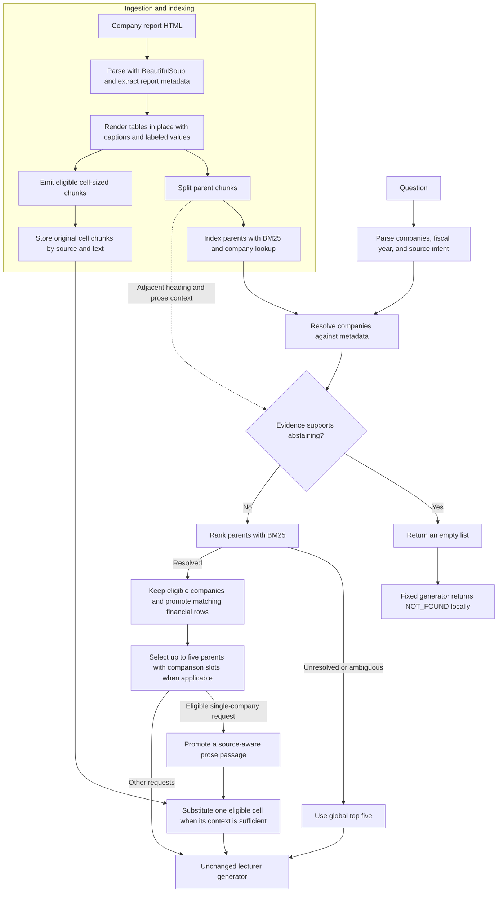

# FTEC5660 Homework 4

## Homework 4 solution

### 1. Final pipeline

`chunk_document()` reads the report heading and title with BeautifulSoup, attaching `source`, `company`, `fiscal_year`, and `doc_type` to each chunk. It renders tables in place so printed values retain their row labels and column headers, with captions carrying units and scope. The flattened document is split into parent chunks of up to 1,500 characters with 200 characters of overlap. Eligible annual-report cells are emitted with their caption, row, column, and value. The index ranks parents with lowercase whitespace BM25 and stores cells for lookup. Lexical ranking is deterministic and meets the handout's restrictions on embeddings and vector stores. For each question, deterministic parsing supplies the requested companies, year, and source intent. Company resolution and the historical evidence check run before ranking. When the policy keeps the question, unresolved company matches use the global order, while resolved matches restrict the candidates. Annual-report queries can promote numeric rows with matching labels, and comparisons reserve company slots when the budget permits. Eligible single-company queries can promote one prose passage and then replace one parent with a sufficient cell chunk. Retrieval returns up to five chunks already emitted by `chunk_document()`. The fixed lecturer generator receives the question and those chunks with provenance headers. [Implementation](hw4.py)

### 2. Experimental methodology

The public set contains 40 HTML documents from 10 fictional companies. Its 60 questions comprise 12 fact, 22 table, 12 comparison, and 14 unanswerable questions. The handout's B0 control flattens HTML with BeautifulSoup `get_text()`, uses recursive splitting and report metadata, and retrieves global BM25 top five with an empty query parse and no abstention. **Complete Recall@5** requires every scored fact to appear as printed in a retrieved chunk from an accepted source. **Answer accuracy** counts answers accepted by the unchanged lecturer grader over all 60 questions. Task 3 uses the share of answerables kept and the share of unanswerables rejected with an empty list. An unanswerable question can earn Task 4 credit from `NOT_FOUND` even when retrieval returned chunks. [Public fixtures](public_test) · [B0 protocol](evaluation/b0/README.md)

V1 through V6 are sequential one-component changes. Tracks C and B each branch independently from V6, and the combined run adds B to C. V8 changes the abstention policy on top of C+B. Each native measurement below is a single lecturer-generator run. C+B also has a separate one-run clean-clone verification that repeated its score. V2 was evaluated offline and inherits the V1 generator reference from byte-identical prompts. The records pin source revisions, fixture hashes, dependencies, and offline ranking or prompt traces. Each earlier ablation should be replayed on its recorded revision. The private set uses other companies, values, and some different wording within the same document templates and question proportions. Its score and run-to-run generator variability remain unmeasured. [Dependency lock](evaluation/b0/requirements.lock) · [C+B verification](evaluation/cb/README.md) · [V8 reproduction](evaluation/v8/README.md#reproduction)

### 3. Public ablation results

Every variant kept all 46 answerables and made zero student model calls. Automatic scores cover Tasks 1–4. Recall counts complete evidence hits, including all required facts for comparisons.

| Variant and parent | Component changed | Recall@5 | Correct answers | Rejected | Points / 75 | Evidence |
|---|---|---:|---:|---:|---:|---|
| B0 | Naive global BM25 | 13/46 | 28/60 | 0/14 | 21.33 | [Run](evaluation/b0/runner.txt) |
| V1 from B0 | Table-aware extraction | 18/46 | 33/60 | 0/14 | 31.00 | [Run](evaluation/v1/runner.txt) |
| V2 from V1 | Deterministic query parsing | 18/46 | 33/60 inherited | 0/14 | 41.00¹ | [Offline record](evaluation/v2/README.md) |
| V3 from V2 | Company metadata filtering | 25/46 | 40/60 | 0/14 | 44.96 | [Run](evaluation/v3/runner.txt) |
| V4 from V3 | Comparison slot allocation | 25/46 | 40/60 | 0/14 | 44.96 | [Run](evaluation/v4/runner.txt) |
| V5 from V4 | Conservative abstention | 25/46 | 40/60 | 7/14 | 49.96 | [Run](evaluation/v5/runner.txt) |
| V6 from V5 | Financial-row-aware ranking | 44/46 | 56/60 | 7/14 | 68.67 | [Run](evaluation/v6/runner.txt) |
| Track C from V6 | Source-aware prose retrieval | 46/46 | 58/60 | 7/14 | 69.33 | [Run](evaluation/cb/research/track-c-runner.txt) |
| Track B from V6 | Cell-sized evidence retrieval | 44/46 | 58/60 | 7/14 | 69.33 | [Run](evaluation/cb/research/track-b-runner.txt) |
| C+B from Track C | Add cell-sized evidence to prose retrieval | 46/46 | 60/60 | 7/14 | 70.00 | [Run](evaluation/cb/research/combined-runner.txt) · [Verification](evaluation/cb/verification/runner.txt) |
| V8 from C+B | Historical evidence-aware abstention | **46/46** | **60/60** | **10/14** | **72.14** | [Run](evaluation/v8/verification/native/runner.txt) |

¹ V2's total combines its measured Task 1–3 scores with V1's 11.00/20 for Task 4. All 300 ranked positions and all 60 generator prompts matched V1. No V2 generator run was made. [V2 manifest](evaluation/v2/manifest.json)

V8 earned the full 8/8 for table rendering, 7/7 for chunking, 5/5 for valid retrieval, 10/10 for parsing, 15/15 for recall, and 20/20 for answer accuracy. Task 3 contributed 7.14/10. Task 2.3 already awarded full points to V6 because 44/46 exceeded the 90% threshold. The remaining retrieval gains therefore show up in raw evidence hits and answer accuracy. [V6 grader](evaluation/v6/runner.txt) · [V8 grader](evaluation/v8/verification/native/runner.txt)

### 4. Why each intervention helped

- **V1 · Preserve table relationships.** Binding captions, rows, and columns to printed values should make financial evidence easier to find and interpret. Rendering rose from 0/8 to 8/8, and table hits rose from 3/22 to 6/22. The correct FY2024 Corvane gross profit was now readable but still ranked 160th. Preserving the evidence made later ranking improvements possible. [Ranked examples](evaluation/v1/README.md#where-retrieval-changed)
- **V2 · Parse query fields.** A deterministic parser should identify the subject, requested year, and source intent that later retrieval rules need. It scored 180/180 fields, up from 0/180. Retrieval remained global at this stage, so the parse gain was independently visible in Task 2.2. [Field scores](evaluation/v2/parsed.json) · [Rank and prompt control](evaluation/v2/README.md#retrieval-control)
- **V3 · Filter by company.** Unrelated issuers compete for five slots when text uses similar names and financial terms. Filtering the global BM25 order to resolved company candidates gained seven complete hits and lost none. The Northgate Robotics net receivables evidence moved from rank 17 to rank one. [V3 rank trace](evaluation/v3/ranks.json)
- **V4 · Allocate comparison slots.** Reserving a slot per resolved comparison company raised both-company representation from **7/12 to 12/12**. Complete comparison recall stayed at **4/12**. For the Kestrel–Halcyon net income comparison, the reserved Halcyon passage did not contain the required figure, which was at eligible rank nine. Slot allocation solves crowding by one issuer. Each reserved passage still has to contain the requested fact. [V4 comparison trace](evaluation/v4/comparisons.json)
- **V5 · Reject clear absence.** Checks for clearly absent companies and unsupported historical periods returned seven correct empty lists, with the 53 retained rankings unchanged. Task 3 rose from 0 to 5, and generator calls fell from 60 to 53. The generator had already answered those seven correctly with `NOT_FOUND`, so the intervention did not improve accuracy. [Abstention decisions](evaluation/v5/abstentions.json) · [V4 answers](evaluation/v4/results.csv)
- **V6 · Rank by financial row.** Moving chunks with an exact normalized numeric row-label match ahead of other candidates promoted 19 additional complete hits, the largest retrieval gain. Table hits rose from 11/22 to 22/22, and comparison hits from 4/12 to 12/12. V1 supplied the row structure. V6 turned it into a ranking signal while retaining BM25 order within each group. [V6 ranks and scorecard](evaluation/v6/README.md)
- **Track C · Find prose disclosures.** Scanning company passages for topical language, stated periods, and source cues promoted the Lumen Harbor Foods auditor and the USD 75m repurchase announcement in the Northgate Payments earnings call. Both reached rank one. The independent run gained two complete hits and two correct answers. [Frozen trace](evaluation/cb/reference.json) · [Track C answers](evaluation/cb/research/track-c.csv)
- **Track B · Narrow an eligible cell.** A labeled regional revenue cell preserves the requested value while reducing competition from adjacent years and regions. With recall unchanged, the independent run corrected the Orchid Bay Hotels FY2023 Asia Pacific value and the Brightwater Software FY2023 Europe, Middle East and Africa value. Restricting substitution to eligible cells keeps the caption, period, row, and recognized units together. [V6 answers](evaluation/v6/results.csv) · [Track B answers](evaluation/cb/research/track-b.csv)
- **C+B · Combine the two retrieval changes.** The combined run corrected all four V6 errors that the stand-alone tracks had corrected separately, with no correct answers lost. The separate clean-clone run reproduced 46/46 complete hits and 60/60 correct answers. [Combined answers](evaluation/cb/research/combined.csv) · [Verification audit](evaluation/cb/verification/audit.json)
- **V8 · Check historical evidence before abstaining.** The new policy inspects company-wide coverage for eligible historical requests. It preserves retrieval for genuine comparative and relative-period financial evidence, including amounts associated with adjacent headings. The narrow officer-intent exemption sends identity and tenure cases through the prior policy if the new historical check would otherwise reject them. The policy correctly rejected three more questions about unsupported periods for total assets, operating cash flow, and operating income. All 50 retained rankings and prompts matched C+B, and accuracy stayed at 60/60. The gain was 2.14 points in Task 3, with three fewer generator calls. [V8 offline comparison](evaluation/v8/verification/offline.json) · [V8 live audit](evaluation/v8/verification/live-audit.json)

### 5. Error analysis and limitations

- **Ranking and company coverage.** V6 could access the auditor and repurchase evidence at eligible ranks 12 and 8, outside the output cutoff. In a V4 cash comparison, slot allocation brought one required cash figure into rank five while the other stayed outside the selected chunks. [V6 evidence gaps](evaluation/v6/README.md#v5-failure-diagnosis) · [V4 comparison trace](evaluation/v4/comparisons.json)
- **Correct evidence, wrong value.** V6 retrieved the correct Asia Pacific figure of 316.2, but the generator selected 349.0 from FY2024. It also selected 158.1 for the Americas instead of 493.5 for Europe, Middle East and Africa. Cell substitution fixed those public errors. Synthetic controls required the parent to stay when a scale or a constant-currency qualifier appeared only in adjacent prose. Unrecognized footnotes or qualifiers remain a risk when narrowing. [V6 error diagnosis](evaluation/v6/README.md#scorecard) · [Cell-context tests](test/test_combined_retrieval.py)
- **Plausible prose from the wrong source.** Held-out tests found that an auditor's legal suffix could boost a wrong-year call over the requested annual report. A broker's passage about a peer auditor could also displace the correct annual passage. Company filtering resolves the filing's subject, while text inside the filing can discuss another company. [C+B risk review](evaluation/cb/README.md#remaining-risks-and-rationale)
- **False abstentions in research controls.** The rejected V7 tenure-date rule missed financial disclosures anchored indirectly to a governance date. Earlier V8 prototypes missed prose with relative periods, units inherited from headings, and synonyms such as “operating earnings” and “profit after tax.” Heading boundaries and the officer exemption address observed cases within the final historical check. A separate V8 vocabulary-based probe failed on unfamiliar but valid disclosures, and the bounded Track D model verifier gained no new public rejections. These probes were feasibility studies. [V8 regression replay](evaluation/v8/verification/research-regressions.json) · [V8 integration risks](evaluation/v8/README.md#remaining-private-set-risks)
- **Remaining unanswerables.** The four retained cases ask for FY2025 lobbying spend, carbon-offset purchase spend, revenue from the largest single customer, and customer churn. The available aggregate expenses, climate-risk descriptions, geographic sales, and qualitative retention leave the requested quantities unresolved. The fixed generator returned `NOT_FOUND` for all four. A new rule based on missing keywords could reject a real disclosure phrased differently. Identical private performance cannot be inferred from one public run. [V8 per-question results](evaluation/v8/verification/native/results.csv)

### 6. Engineering conclusions and learning reflections

**Chunking is an information-modelling decision, not just a size limit.** I initially understood our B0 approach as turning a source into plain text, splitting it into chunks, ranking them with BM25 and returning the top five. That made the pipeline easy to follow, but it raised a more important question: *does each chunk still make sense in relation to the document it came from?* The 200-character overlap helps retain context across boundaries, but cannot restore relationships already lost when HTML tables are flattened. V1 showed why a financial value needs its row label, year and units to travel with it. V6 then showed that preserving these relationships was only half the job: matching those labelled rows during retrieval produced the largest improvement in evidence recall. Better representation made better selection possible.

**The five-space car park analogy helped me distinguish filtering from allocation.** Imagine the five retrieved chunks as parking spaces and passages about two companies as blue and red cars. V3's metadata filtering keeps unrelated cars out, so they cannot occupy spaces needed by the relevant companies. But BM25 can still fill all five spaces with blue cars. V4 reserves at least one space for each colour and lets relevance determine the remaining spaces. Company representation increased from 7/12 to 12/12 comparison questions, yet complete comparison evidence stayed at 4/12. In other words, parking a red car does not guarantee it is carrying the requested cash or income figure. **Source coverage and fact coverage are different objectives.** V6's financial-row ranking finally addressed what those cars were carrying.

**Finding the right passage is different from making its answer unambiguous.** Even after V6 retrieved complete evidence, the generator sometimes chose a neighbouring year or region. Track C recovered prose about an auditor and an earnings-call announcement; Track B reduced ambiguity by supplying a narrower, labelled financial cell. Their independently measured gains were complementary, and the combined run recovered all four remaining public errors. This reinforced the idea that the best retrieval unit is not necessarily the smallest chunk: it is the smallest *self-contained* piece of evidence, preserving the source, metric, period, units and any qualifiers needed to interpret it.

**Abstention needs stronger evidence than ranking.** V5 improved the retriever's rejection of unanswerable questions and saved generator calls, but accuracy did not change: the fixed generator was already returning `NOT_FOUND` for those cases. A low-ranked or missing phrase is not proof that a disclosure is absent. The historical-abstention experiments made this concrete: financial periods can be implied by comparative columns, surrounding prose or even an appointment date referenced by a financial statement. V8 improved the public abstention score by retaining plausible historical evidence and distinguishing officer intent, but the remaining undisclosed metrics resisted reliable automatic rejection. An imperfect ranking signal may still be useful; a mistaken abstention eliminates the opportunity to answer.

Taken together, the experiments changed how I think about RAG. Rather than treating it as one similarity search, I now think in terms of **representation → candidate selection → evidence coverage → answer interpretation → abstention**, with a distinct failure mode and measurement at each stage. These conclusions are supported by the public tests; they do not establish equivalent performance on the unseen private set.

